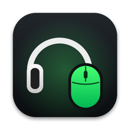

<p align="center">
  
</p>

<h1 align="center">Fone</h1>

<p align="center">
  Controle o <b>Razer BlackShark V3 Pro</b> e o <b>Attack Shark X6</b> direto da barra de menu do macOS,<br>
  sem Razer Synapse e sem o app da Attack Shark (que nem existem para Mac).
</p>

<p align="center">
  <a href="../../releases/latest"></a>
  
  
  
</p>

---

## ✨ O que faz

**Na barra de menu** — `🎧 84% ⚡ 🎙̸  🖱 100%`

O ícone mostra a bateria dos dois aparelhos e muda de acordo com o estado: ⚡ carregando,
🎙̸ microfone mutado, **BT** quando ligado por Bluetooth, e esmaecido quando desligado.
Um clique abre um painel com os controles rápidos.

### 🎧 Razer BlackShark V3 Pro
| | |
|---|---|
| 🔋 Bateria e carregamento | leitura ao vivo pelo dongle |
| 🔇 Cancelamento de ruído | Desligado · ANC · Ambiente, intensidade 1–10 |
| 🗣️ Sidetone | 0–100 |
| 🎚️ Equalizador do fone | 6 slots × 10 bandas (−12 a +12 dB), escolha do slot ativo |
| 🎙️ Microfone | presets e EQ de 10 bandas, aviso de mute |
| ⏻ Desligamento automático | nunca, 5, 15, 30, 45 ou 60 min |

### 🖱️ Attack Shark X6
| | |
|---|---|
| 🔋 Bateria | pelo heartbeat do dongle |
| 🎯 DPI | até 6 estágios (50–26 000), cor de cada estágio, estágio ativo — também acompanha o botão físico |
| ⚡ Polling rate | 125 · 250 · 500 · 1000 Hz |
| 📐 Sensor | lift-off 1/2 mm, angle snapping, ripple control |
| 💡 Iluminação | desligada, fixa, respirando, cor do DPI; velocidade e cor |
| 😴 Energia | tempo para dormir, sono profundo, debounce |

### Também
- **Widget** de mesa (pequeno e médio) com a bateria dos dois.
- Detecta se cada aparelho está no **dongle 2.4 GHz**, no **cabo USB** ou no **Bluetooth**.
- **Inicia com o Mac** (pode desligar no painel).

## 📥 Instalação

1. Baixe o **`Fone.zip`** na [página de releases](../../releases/latest) e descompacte.
2. Arraste o **Fone.app** para **Aplicativos**.
3. Na primeira vez, o macOS vai bloquear (o app não é assinado por um desenvolvedor Apple pago).
   Libere de um destes jeitos:
   - **Ajustes do Sistema › Privacidade e Segurança** → "Abrir Mesmo Assim", ou
   - no Terminal:
     ```bash
     xattr -dr com.apple.quarantine /Applications/Fone.app
     ```
4. Abra o Fone. Se o macOS pedir acesso ao **Bluetooth**, aceite — é só para saber se os aparelhos estão conectados por BT.

> Os controles funcionam pelos **dongles USB 2.4 GHz** (e pelo cabo, no fone). Por Bluetooth,
> o app só mostra conexão e bateria — os protocolos de configuração não passam por BT.

## 🛠️ Compilar

Precisa do Xcode (ou das Command Line Tools) — sem projeto Xcode, só `swiftc`:

```bash
./build.sh               # compila para este Mac, instala em ~/Applications e abre
RELEASE=1 ./build.sh     # binário universal + build/Fone.zip
```

| Pasta | Conteúdo |
|---|---|
| `Shared/` | Protocolos HID ([BlackShark](Shared/BlackSharkProtocol.swift), [Attack Shark](Shared/AttackSharkProtocol.swift)) e estado compartilhado app ↔ widget |
| `App/` | Transporte IOKit HID, controladores, telas SwiftUI, detecção Bluetooth |
| `Widget/` | Extensão WidgetKit |
| `Support/` | Info.plist, entitlements, ícone ([gerador](Support/Icon/make_icon.swift)) |
| `tools/` | Sondas em Python (`pip install hidapi`) para investigar os aparelhos |

## 🔬 Protocolos

<details>
<summary><b>Razer BlackShark V3 Pro</b> (dongle <code>1532:0577</code>, cabo <code>1532:0576</code>)</summary>

Relatórios HID **output/input de 64 bytes**, report ID `0x02`, coleção vendor `FF14:0001`:

```
[0] 02  [2] 60  [6] 4+n  [9] 80  [10] comando  [12] n  [13..] dados  [62] XOR(0..61)
```

| GET | SET | |
|---|---|---|
| `21` | — | bateria % |
| `2A` | — | carregando |
| `12` | `92` | ANC: modo (0 off, 1 ANC, 80 ambiente) + nível 1–10 |
| `15` + slot | `95` | EQ do fone (10 bandas, sinal-magnitude) |
| `60` + slot | `E0` | tabela de slots (ativo/habilitado) |
| `16` / `17` | `96` / `97` | preset / EQ do microfone |
| `19` | `99` | sidetone |
| `2C` | `AC` | desligamento automático |
| `55` | — | mute do microfone |

Escritas de EQ do fone ficam entre `E1 01` e `E1 02`. A resposta tem `[1] = 02` em caso de sucesso.
</details>

<details>
<summary><b>Attack Shark X6</b> (dongle Beken <code>1d57:fa60</code>, interface 2)</summary>

Configuração por **SET_REPORT feature**; o mouse **não permite ler** as configurações de volta,
então o app guarda o estado e reenvia o relatório completo a cada mudança.

| Report | Tamanho | Conteúdo |
|---|---|---|
| `0x04` | 52 B | DPI (`DPI/50 − 1`, 16 bits), máscara de estágios, estágio ativo, cores, lift-off, angle, ripple; checksum = soma de `[3..49]` em `[50..51]` |
| `0x05` | 13 B | iluminação, cor, velocidade, sleep (`min×2`), sono profundo, debounce; checksum em `[11..12]` |
| `0x06` | 9 B | polling: `1000/Hz` e complemento |

O dongle confirma com o input report `03 10 50 00 <id>` e envia `03 10 40 01 <bateria/10>` como heartbeat.
</details>

## 🙏 Créditos

O mapeamento dos protocolos se apoia no trabalho de engenharia reversa de:
- [openrazer/openrazer#2838](https://github.com/openrazer/openrazer/issues/2838) e
  [infinityInfinite/secbird#18](https://github.com/infinityInfinite/secbird/pull/18) — BlackShark V3 Pro
- [blak0p/attack-shark-linux](https://github.com/blak0p/attack-shark-linux) — Attack Shark X6

Tudo foi conferido nos aparelhos reais no macOS.

## ⚠️ Aviso

Projeto independente, sem relação com Razer Inc. ou Attack Shark. Os nomes são usados só para
identificar os aparelhos compatíveis. Use por sua conta e risco — no X6, "Enviar tudo" substitui a
configuração que está no mouse.

Licença [MIT](LICENSE).
